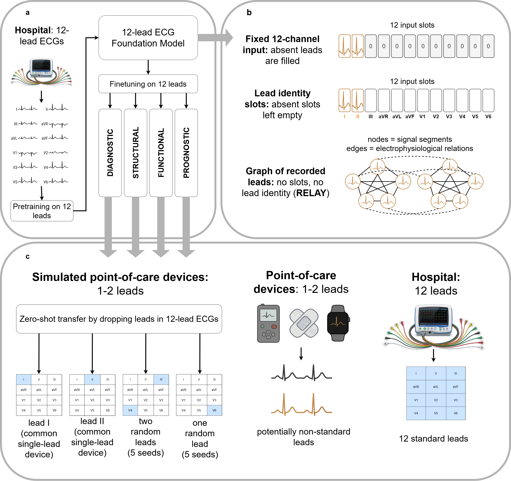

[](https://doi.org/10.5281/zenodo.24285393) [](https://arxiv.org/abs/2608.03690)

# RELAY — An ECG foundation model for zero-shot transfer from hospital to point-of-care devices

<p align="center">
  
</p>

This is the official repository of `An ECG foundation model for zero-shot transfer from hospital to point-of-care devices`. It contains:

- **RELAY** (`relay_code/`): a graph-based ECG foundation model. It processes any subset of leads natively, without zero-padding or changes to the architecture.
- **A benchmarking pipeline** (`code/`), built on PyTorch Lightning, with wrappers for RELAY and seven prior ECG foundation models:
  - ECGFounder
  - ECG-JEPA
  - ST-MEM
  - MERL
  - ECGFM-KED
  - HuBERT-ECG
  - ECG-CPC
- **Scripts to reproduce the experiments.** Every model is fine-tuned on 12 leads only. Its checkpoints are then tested, without any retraining:
  - on 12 leads;
  - on lead I only and on lead II only;
  - on 1 and on 2 randomly drawn leads;
  - on two point-of-care datasets of single-lead recordings, CinC 2017 and Icentia11k.

```
code/              benchmarking pipeline (main_lite.py) and the wrappers of all foundation models (clinical_ts/models/fm_ecg.py)
relay_code/        RELAY model code, loaded by the pipeline
*.sh               fine-tuning and test entry points (see below)
zero_shot/         zero-shot point-of-care transfer: CinC 2017 and Icentia11k
pretrained_models/ where the scripts look for the pretrained checkpoints
```

---

## 1. Environment

Everything in this repository runs in one conda environment, which uses Python 3.13, CUDA 12.6 and PyTorch 2.7.1:

```bash
conda env create -f env.yaml
conda activate lightning3
```

Without conda, use the equivalent pip setup:

```bash
python3.13 -m venv .venv && source .venv/bin/activate
pip install -r requirements.txt
```

The S4 layers of ECG-CPC run faster with the CUDA Cauchy kernel: `cd code/extensions/cauchy && python setup.py install`. Without it, an equivalent PyTorch kernel is used.

---

## 2. Datasets

### 12-lead datasets (fine-tuning and reduced-lead tests)

| Dataset | Source |
|---|---|
| PTB-XL | https://physionet.org/content/ptb-xl/1.0.3/ |
| PTB | https://physionet.org/content/ptbdb/1.0.0/ |
| CPSC2018, CPSC-Extra, Georgia, Ningbo | https://physionet.org/content/challenge-2021/1.0.3/ |
| Chapman | https://figshare.com/articles/dataset/Chapman_ECG_dataset/25558926 |
| SPH | https://figshare.com/articles/figure/SPH/22199548?file=39453271 |
| CODE-15% | https://zenodo.org/records/4916206 |
| EchoNext | https://physionet.org/content/echonext/1.1.0/ |
| ZZU pECG | https://doi.org/10.6084/m9.figshare.27078763 |
| Hefei | https://tianchi.aliyun.com/competition/entrance/231754/information |

Put every dataset in its own folder at the repository root, using the folder names that the scripts expect:
- `ptb-xl/records500`, `ptb`, `cpsc2018`, `cpsc_extra`, `georgia`, `ningbo`;
- `chapman/ECGData`, `sph`, `code15`, `echonext`, `zzu_pecg`, `hefei`.

To use another location, set `DATASET_DIR` in the scripts. Then convert each dataset to the memmap format of the pipeline:

```bash
jupyter notebook preprocess_ecg_dataset.ipynb
```

```
<dataset_dir>/
├── df_memmap.pkl                  # DataFrame: strat_fold, label, patient_id, ...
├── memmap_meta_preprocessed.npz
├── memmap_*_preprocessed.npy
└── lbl_itos.npy
```

### Point-of-care datasets (zero-shot tests)

Both datasets download from PhysioNet's open-data mirror without credentials:

```bash
cd zero_shot
python download.py cinc2017                     # CinC 2017 (AliveCor single lead), 1.4 GB
python build_cinc2017.py                        # -> cinc2017/  (AF vs Normal, 5,834 records)

python download.py icentia11k_atr --workers 32  # Icentia11k annotations only (~30 GB)
python scan_icentia11k.py --procs 8             # 10-s windows x rhythm / beat content
python select_icentia11k.py                     # -> icentia11k/selected_windows.csv, selected_segments.txt
python download.py icentia11k_dat --records ../icentia11k/selected_segments.txt
python build_icentia11k.py --procs 16           # -> icentia11k/  (SR, AFIB, AFLT, PVC, PAC)
```

---

## 3. Pretrained checkpoints

Download the published checkpoint of each prior model from the link given in the paper's appendix. Place the files in the following subfolders of `pretrained_models/`:

| Folder | Files |
|---|---|
| `ecg_founder/` | `12_lead_ECGFounder.pth` |
| `ecg_jepa/`    | `multiblock_epoch100.pth` |
| `st_mem/`      | `st_mem_vit_base_full.pth` |
| `merl/`        | `res18_best_encoder.pth` |
| `ecgfm_ked/`   | `best_valid_all_increase_with_augment_epoch_3.pt` |
| `hubert_ecg/`  | `hubert_ecg_base.safetensors` |
| `cpc/`         | `last_11597276.ckpt` (`config_last_11597276_ckpt.yaml` is included) |
| `relay/`       | `pretrained.pt` (`config.json` is included) |

The RELAY checkpoint will be released.

---

## 4. Reproducing the experiments

Launch every script from the repository root, either with `bash <script>` or with `sbatch <script>`; each script has SLURM headers. The configuration block at the top of each script holds:
- `BASE_DIR`, which defaults to the current directory;
- `CHECKPOINTS_DIR` and `DATASET_DIR`;
- the lists of `MODELS`, `DATASETS` and seeds.

Runs that have already finished are skipped, so a script can be relaunched safely. Every test run saves its per-record predictions (`test_0_epoch_0_{agg,noagg}.npz`).

### 4.1 Fine-tuning on 12 leads

This is the only training step. All 8 models are fine-tuned on the 14 datasets with the same recipe:
- AdamW, learning rate 1e-3 for the head and 1e-4 for the encoder, weight decay 1e-3, constant schedule;
- batch size 64, up to 100 epochs, `finetuning_linear` head;
- model selection on the validation fold, training seed 42.

```bash
bash sft_12_lead.sh                  # 8 models x 14 datasets -> 12_lead_benchmark/finetuning_linear/
```

### 4.2 Tests on 12 leads and on fewer leads (no retraining)

The checkpoints from 4.1 are tested as they are:

```bash
bash test_random_leads_12lead_models.sh   # 12 leads, and k random leads (seeds 42-46) -> ktest_12lead_models/
bash test_lead_I_II_12lead_models.sh      # lead I only, lead II only                  -> lead_I_II_test_12lead_models/
bash test_st_mem_native_12lead_models.sh  # ST-MEM on the present leads only (no zero-padding,)
```

The paper reports k = 1, 2 and 12. `TEST_LEADS` in `test_random_leads_12lead_models.sh` sets which k are run; k = 12 is deterministic and uses seed 42 only.

- ECGFounder, ECG-JEPA, ECG-CPC, MERL, KED, and HuBERT-ECG receive a zero-filled tensor when leads are absent.
- ST-MEM natively encodes only the present ones, but requires knowing their identities in the standard 12-lead template
- RELAY builds a graph containing only the `k` leads actually present and does not require their identities nor their position in the template

The random draws depend only on the seed, so every model is tested on the same lead subsets.

### 4.3 Zero-shot transfer to point-of-care recordings

The PTB-XL All checkpoints from 4.1 are applied as they are, with no training. The single recorded lead is placed in one lead slot of a zero-filled 12-lead input:
- CinC 2017 uses the lead I slot.
- Icentia11k uses every slot in turn, because its patch lead is not a standard lead.

```bash
ORACLE=1 bash zero_shot/run_poc_zero_shot.sh   # all models, CinC 2017 (slot I) + Icentia11k (12 slots)
python zero_shot/eval_poc_zero_shot.py         # AUROC per head, Icentia11k averaged over slots -> zero_shot/results/summary_*.csv
python zero_shot/make_poc_tables.py            # LaTeX tables
```

### 4.4 Metrics and confidence intervals

Every test run of `code/main_lite.py` reports the macro and per-class AUROC with 95% confidence intervals from 1,000 record-level bootstrap resamples. Bootstrapping is on by default. The test scripts pass `--no-bootstrap` to save time (same point estimates); remove it from the script to get the confidence intervals.

Threshold-based metrics are optional (`code/clinical_ts/utils/eval_utils_threshold.py`) and are bootstrapped in the same way:

| flag | reports |
|---|---|
| `--threshold-metrics` | sensitivity at specificity `--sens-at-spec` (default 0.90 0.95) and specificity at sensitivity `--spec-at-sens` (default 0.80 0.90), per class and macro, with the threshold chosen on the evaluated predictions |
| `--export-thresholds FILE.json` | the per-class thresholds at the `--sens-at-spec` targets (smallest score t with specificity(score > t) above the target) |
| `--fixed-thresholds FILE.json` | sensitivity, specificity, balanced accuracy and PPV (at the sample prevalence) of every matching class at those fixed thresholds |

For example, to fix thresholds on the PTB-XL All validation fold and apply them unchanged to CinC 2017, with `<model args>` as in `test_random_leads_12lead_models.sh`:

```bash
python code/main_lite.py <model args> --data ptb-xl/records500 --fs-data 500 --finetune-dataset ptbxl_all \
       --finetune --epochs 0 --eval-only <ptbxl_all best_model.ckpt> --eval-split val \
       --export-thresholds thresholds/<model>.json        # add --fixed-leads I for thresholds chosen on lead I only
python code/main_lite.py <model args> --data cinc2017 --fs-data 300 --finetune-dataset cinc2017 --single-lead-slot I \
       --finetune --epochs 0 --eval-only <ptbxl_all best_model.ckpt> --fixed-thresholds thresholds/<model>.json
```

## 📚 Citation
If you use our model or find our work useful, please consider giving us a star ⭐ and citing us:
```
@misc{coppola2026ecgfoundationmodelzeroshot,
      title={An ECG foundation model for zero-shot transfer from hospital to point-of-care devices}, 
      author={Edoardo Coppola and Stefano Fiorini and Pietro Liò and Mattia Savardi and Alberto Signoroni},
      year={2026},
      eprint={2608.03690},
      archivePrefix={arXiv},
      primaryClass={cs.LG},
      url={https://arxiv.org/abs/2608.03690}, 
}
```
